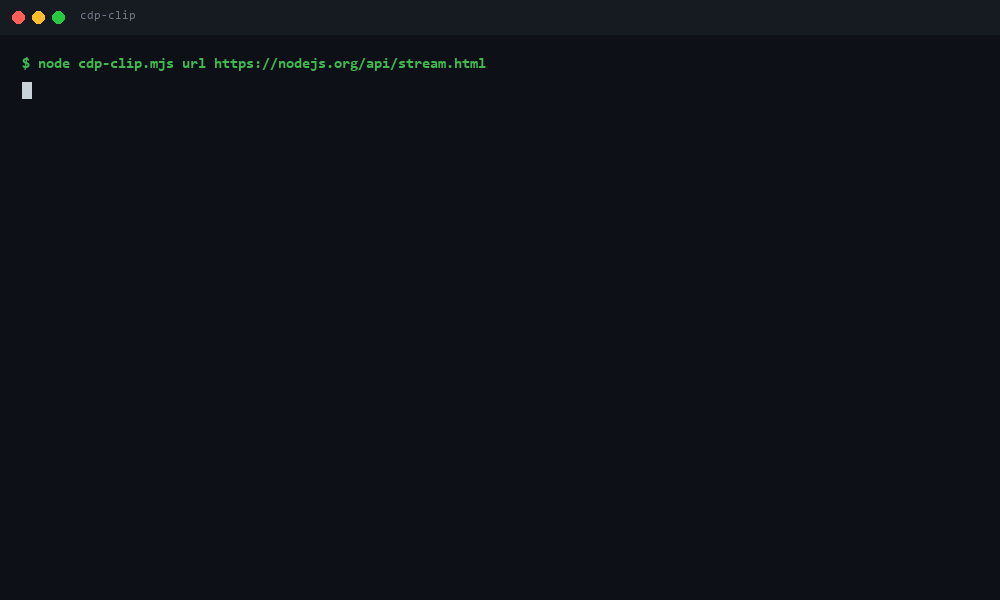

# cdp-clip



**把任意浏览器标签页剪成干净的 Markdown —— 直接走 Chrome DevTools Protocol。**

单文件、零依赖。不装扩展、不用书签、不搬登录态。

能读**你已登录的页面**，能无头跑在脚本里，剪完直接喂给 LLM。

[English](README.md)

---

## 为什么还要再造一个剪藏工具

市面上的方案都有墙：

- **浏览器扩展**要申请站点权限，遇到严格 `Content-Security-Policy` 的站直接注入失败，
  改一行代码还要过商店审核；
- **复制粘贴**字留下了，结构没了——代码块、表格、嵌套列表、链接全变成平文本；
- **Puppeteer / Playwright** 能用，但为了读一个页面装 300MB 的 `node_modules` 不划算。

## 为什么是 CDP

Chrome、Edge、Brave 这些 Chromium 内核浏览器**本身就带远程控制协议**。
`cdp-clip` 只是连上它，发一次 `Runtime.evaluate` 把正文抽出来：

| | 浏览器扩展 | 复制粘贴 | `cdp-clip` |
|---|---|---|---|
| 能读登录态 / 内网页面 | 看 CSP 脸色 | 能 | **能** |
| 保留代码块、表格、嵌套列表 | 能 | 不能 | **能** |
| 无头跑在 CI 或定时任务里 | 不能 | 不能 | **能** |
| 需要安装的东西 | 一个扩展 | 无 | **无** |
| 碰 cookie 或凭证 | 要站点权限 | 不碰 | **不碰** |

只读是构造上保证的：一次 evaluate，不点击、不跳转、不读 cookie、不留下注入的脚本。

## 30 秒开始

```bash
git clone https://github.com/Sunney-fly/cdp-clip.git
cd cdp-clip

# 一次性：拉起临时无头浏览器 → 抓页面 → 关掉
node cdp-clip.mjs url https://nodejs.org/api/stream.html --stdout

# 或者装到全局
npm i -g .
cdp-clip url https://example.com
```

要求：**Node >= 22**（自带 `fetch` 和 `WebSocket`）+ 任意已安装的 Chromium 浏览器
（Edge / Chrome / Brave / Chromium，自动探测）。没有别的依赖。

## 两种模式

### 一、`url`：给脚本用

用一个临时 profile 拉起无头浏览器，打开 URL，等页面 hydration 完成，剪完就关：

```bash
cdp-clip url https://example.com/article --out=./notes
cdp-clip url https://example.com/article --json | jq -r .markdown
```

### 二、`clip`：剪你正在看的那个标签页

适合登录后才有内容的页面。先开一个带调试端口的浏览器，正常登录，再剪：

```bash
cdp-clip launch                 # 打开 Edge/Chrome，带 --remote-debugging-port=9222
#   ……正常登录，切到要剪的页面……
cdp-clip clip                   # 剪当前可见标签页
cdp-clip clip --tab=文档         # 或按标题/URL 片段指定
cdp-clip list                   # 看有哪些可剪的标签页
```

调试端口只监听 `127.0.0.1`。用专用 profile（`cdp-clip launch` 默认放在临时目录），
别在调试浏览器里登网银。

## 输出长这样

```markdown
---
title: "Stream | Node.js v26.13.1 Documentation"
url: "https://nodejs.org/api/stream.html"
host: "nodejs.org"
clipped_at: "2026-11-24T04:08:37.573Z"
words: 24590
tokens_est: 31967
lang: "en"
source: cdp-clip
---

# Stream | Node.js v26.13.1 Documentation

> Source: https://nodejs.org/api/stream.html
> Clipped: 2026-11-24 04:08:37 (nodejs.org, ~24590 words, ~31967 tokens)

## Stream

**Source Code:** [lib/stream.js](https://github.com/nodejs/node/blob/main/lib/stream.js) ...
```

`tokens_est` 是个粗略的预算数（西文词 ≈ 1.3 token，中日韩字符 ≈ 1 token），
让你在喂给模型之前就知道这页装不装得下上下文。

## 参数

| 参数 | 适用 | 作用 |
|---|---|---|
| `--out=<dir>` | `clip`、`url` | 输出目录（默认 `./clips`） |
| `--stdout` | `clip`、`url` | 直接打到标准输出，不写文件 |
| `--json` | `clip`、`url` | 元数据 + Markdown 一起输出为 JSON |
| `--no-frontmatter` | `clip`、`url` | 去掉 YAML 头 |
| `--tab=<序号\|片段>` | `clip` | 按 `list` 的序号或标题/URL 片段选标签页 |
| `--port=<n>` | `clip`、`list`、`status`、`open` | 调试端口（默认 `9222`） |
| `--browser=<edge\|chrome\|brave\|chromium>` | `url`、`launch` | 强制指定浏览器 |
| `--headed` | `url` | 显示窗口（默认无头） |
| `--wait=<ms>` | `url` | 额外等待，给晚 hydration 的页面 |
| 环境变量 `CDP_CLIP_BROWSER` | 全部 | 浏览器可执行文件绝对路径 |

## 保留什么、丢掉什么

1. 给候选容器打分（`article`、`main`、`[role=main]`、`.entry-content`、`.markdown-body`、
   `#content` 等），公式是 `正文长度 − 1.5 × 链接文字长度`——正文赢过导航链接墙；
   都不够好就退回 `<body>`；
2. 删掉 `script`、`style`、`nav`、`footer`、`aside`、`header`、`iframe`、`form`、
   媒体元素和标题锚点；
3. 转换标题、段落、嵌套列表、引用、代码块（带 `class="language-*"` 的语言标记）、
   表格、图片（绝对化 URL）、加粗/斜体/删除线/链接。

## 边界（提 issue 前先看）

- **跨域 iframe 里的正文读不到**，只处理主框架；
- **PDF 不转**：调试浏览器用 PDF 查看器渲染，没有文章 DOM；
- **Canvas / WebGL 应用、DRM 视频页** 没有可提取的文本；
- **重 SPA** 可能需要 `--wait=2000` 甚至更多；
- `url` 模式遇到登录墙就是登录墙——那种页面请用 `clip` 模式 + 已登录的浏览器。

## 设计取舍

- **零依赖是功能，不是炫技。** `fetch` 和 `WebSocket` 是 Node 22 自带的；
  用 `jsdom` + `readability` + `cheerio` 干同样的事要背 40MB。
- **一次 `Runtime.evaluate`，不用 `DOM.getOuterHTML`。** 让页面自己在标签页里序列化成
  Markdown，只把结果传回来——大页面也就几百 KB。
- **attach 模式绝不调 `Page.navigate`。** 剪你正在看的页面，就不该改变那个页面。

## License

MIT
